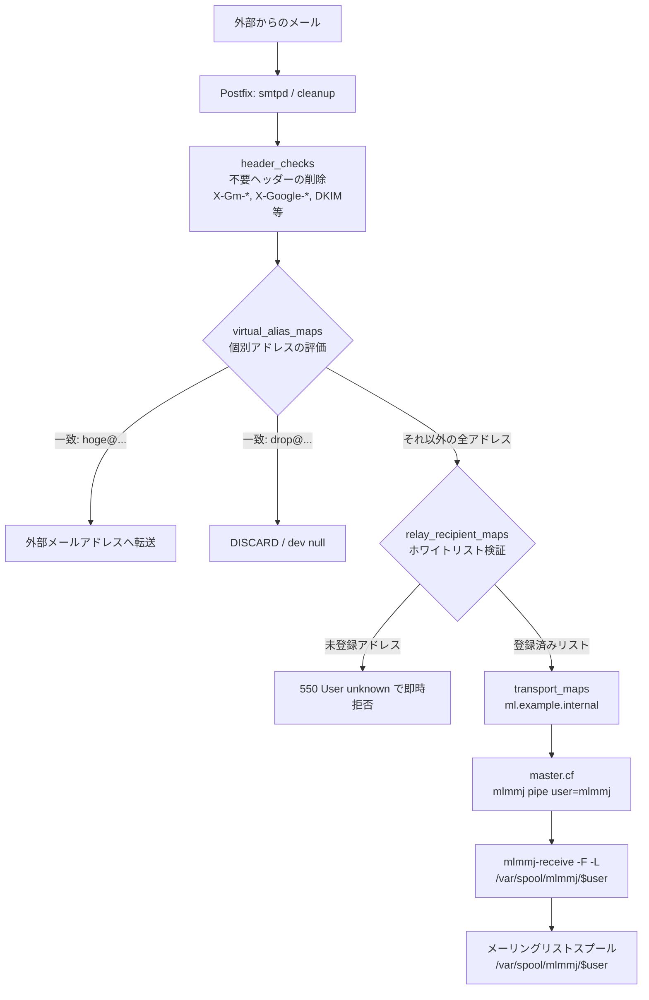

# AlmaLinux 10 ＋ mlmmj メーリングリスト移行・運用ガイド

既存の Mailman 環境の後継として、AlmaLinux 10（RHEL 10 系）上に **mlmmj** と **Postfix** を用いたメーリングリスト環境を構築・移行するための総合ドキュメントです。

## 概要と選定理由

### 背景

- これまで Mailman を運用してきましたが、メーリングリストの利用が縮小傾向にあり今後増えることもなさそうなため、より軽量で管理・保守が楽なものに置き換える方針としました
- 外部データベース（MySQL / PostgreSQL 等）や Web 管理画面を必須とせず、CLI とテキスト設定ファイルのみで完結するシンプルな構成を目指します

### mlmmj（Mail List Management Made Joyful）の利点

- **公式・無償 RPM 提供**: EPEL 10 に最新の `mlmmj 1.7.0` が収録されており、`dnf` で容易に導入・更新可能
- **超軽量・省リソース**: 常駐デーモンや外部 DB が不要。MTA からキックされる C 言語バイナリと、ファイルシステム上のディレクトリ構造のみで動作
- **必要十分な機能**: 会員限定投稿、投稿承認（モデレーション）、バウンス自動処理、Reply-To 制御、件名プレフィックス、日本語・添付ファイル対応などを標準搭載
- **安全かつ容易な移行**: コマンド実行や通知メールを介さず、会員アドレスをテキストファイル（`subscribers.d/members`）として直接配置するだけで移行・会員同期が可能

## アーキテクチャ設計（ドメイン丸ごと Transport 方式）

メーリングリスト専用ドメイン（例: `ml.example.internal`）を運用することを前提とし、最も管理コストの低い **「ドメイン丸ごと Transport 方式」** を採用します。

### 全体アーキテクチャ



### 設計の特長とメリット

1. **ドメイン丸ごと配送とホワイトリスト検証の両立**
   Postfix の `${user}` マクロを活用し、ドメイン全体（`ml.example.internal`）を 1 行の設定で mlmmj にルーティングします。
   同時に `relay_recipient_maps` を併用することで、存在しない宛先宛てのメールを **SMTP 受信時（`RCPT TO`）に 550 で即時拒否** し、誤送信やスパムによるバックスキャッター（不達エラーのばら撒き）を防止します。

2. **特定アドレスの特別扱い（外部転送・破棄）との完全な共存**
   Postfix は `transport_maps` や `relay_recipient_maps` による判定よりも前に `virtual_alias_maps` を評価するため、同一ドメイン内でメーリングリスト以外の特定アドレスを安全に横取りできます：
   - `hoge@ml.example.internal` や `hoge+{alias}@...` を特定メールアドレスへ自動転送
   - `drop@ml.example.internal` や `drop+{alias}@...` を安全に破棄（`/dev/null`）

3. **セキュリティとエラーメッセージの隠蔽**
   Postfix の `default_privs`（全体設定）を変更することなく、`master.cf` の pipe 定義内で `user=mlmmj` を指定するため、最小限の権限で安全に実行できます。
   また、`master.cf` 内で `logger` へパイプすることで、万が一の障害時にも内部パスやエラーログをバウンスメールに露出させず、サーバーの syslog（journald）に集約します。

4. **不要ヘッダーの自動除去**
   Postfix の `header_checks` により、Google 由来の内部ヘッダー（`X-Gm-*`, `X-Google-*`）や不要な `Received`, `DKIM-Signature` を一括除去できます。

## 本番環境 構築・設定手順

### パッケージのインストール

AlmaLinux 10 / RHEL 10 では、EPEL リポジトリからパッケージを導入します。

> **Note**: mlmmj は標準の C ライブラリ（`glibc`）のみに依存するため、CRB（CodeReady Builder）リポジトリの有効化は **不要** です。

```bash
# EPEL リポジトリの追加
dnf install -y epel-release

# mlmmj と Postfix のインストール
dnf install -y mlmmj postfix

# Postfix の自動起動有効化
systemctl enable postfix
```

### Postfix の設定

#### `master.cf` の設定（`/etc/postfix/master.cf`）

末尾に mlmmj 配送用の pipe サービスを追加します。
エラー発生時に内部パスやエラーログをバウンスメールに露出させないよう、`set -o pipefail` と `logger` パイプを用いて syslog（journald）に集約する安全な呼び出し構成としています。

```ini
mlmmj   unix  -       n       n       -       -       pipe
    flags=ORhu
    user=mlmmj
    argv=/bin/bash -o pipefail -c
      { exec /usr/bin/mlmmj-receive -F -L /var/spool/mlmmj/$$1 2>&1 | /usr/bin/logger -t mlmmj-receive -p mail.err }
      -- ${user}
```

#### `main.cf` の設定（`/etc/postfix/main.cf`）

> **Important (RHEL 10 の注意点)**:
> RHEL 10 の Postfix では従来の Berkeley DB（`hash`）形式が廃止され、デフォルトが **`lmdb`** に変更されています。マップ定義には必ず `lmdb:/...` を指定してください。

```ini
# 基本設定
myhostname = ml.localdomain
myorigin = $myhostname
mydestination = localhost, $myhostname
mynetworks = 127.0.0.0/8, 10.0.0.0/8, 172.16.0.0/12, 192.168.0.0/16
smtp_helo_name = ml.example.internal
smtpd_banner = ml.example.internal ESMTP unknown
recipient_delimiter = +
propagate_unmatched_extensions = canonical, virtual, alias

# リレー・ドメイン設定（ml.example.internal を自サーバー宛てとして受付）
relay_domains = ml.example.internal

# マッピングテーブル設定
virtual_alias_maps = lmdb:/etc/postfix/virtual
transport_maps = lmdb:/etc/postfix/transport
relay_recipient_maps = lmdb:/etc/postfix/relay_recipients
alias_maps = lmdb:/etc/aliases, lmdb:/etc/postfix/aliases
mlmmj_destination_recipient_limit = 1

# ヘッダーチェック設定
header_checks = regexp:/etc/postfix/header_checks
```

#### 各種マッピングテーブル・ヘッダー設定

各ファイルを `/etc/postfix/` 配下に作成し、マップをコンパイルして Postfix をリロードします。

- **`/etc/postfix/transport`**（ドメイン全体を mlmmj に向ける）:
  ```ini
  ml.example.internal    mlmmj:
  ```

- **`/etc/postfix/virtual`**（特定アドレスの横取り・外部転送・破棄）:
  ```ini
  hoge@ml.example.internal    hoge@example.com
  drop@ml.example.internal    drop@localhost
  ```

- **`/etc/postfix/aliases`**（ローカル破棄先の定義）:
  ```ini
  drop: /dev/null
  ```

- **`/etc/postfix/relay_recipients`**（存在するメーリングリストのホワイトリスト）:
  ```ini
  announcement@ml.example.internal    OK
  dev-team@ml.example.internal        OK
  ml-test@ml.example.internal         OK
  ```
  ※ `recipient_delimiter = +` が有効なため、ベースアドレスを書いておくだけで `+owner` などのサブアドレスも自動で許可されます。

- **`/etc/postfix/header_checks`**（不要ヘッダーの除去）:
  ```ini
  /^Received:/                IGNORE
  /^DKIM-Signature:/          IGNORE
  /^X-Gm-Features:/           IGNORE
  /^X-Gm-Gg:/                 IGNORE
  /^X-Gm-Message-State:/      IGNORE
  /^X-Google-DKIM-Signature:/ IGNORE
  /^X-Google-Smtp-Source:/    IGNORE
  /^X-Received:/              IGNORE
  ```

設定の反映コマンド（一括実行）：
```bash
postmap /etc/postfix/transport
postmap /etc/postfix/virtual
postmap /etc/postfix/relay_recipients
postalias /etc/postfix/aliases
postfix reload
```

## メーリングリストの作成と制御設定

### リストの初期作成

`mlmmj-make-ml` コマンドを使用します。

```sh
/usr/bin/mlmmj-make-ml -L ml-test -d ml.example.internal -c mlmmj -s /var/spool/mlmmj
```

### 基本制御ファイル（`control/`）

`/var/spool/mlmmj/<listname>/control/` 配下に設定ファイルを配置します（所有者はすべて `mlmmj:mlmmj`）。

|  設定ファイル名  |   種別   |                            内容                            |                                      説明                                       |
| :--------------- | :------: | :--------------------------------------------------------- | :------------------------------------------------------------------------------ |
| `listaddress`    | テキスト | `ml-test@ml.example.internal`                              | リストの正式アドレス                                                            |
| `prefix`         |  文字列  | `[ml-test]`                                                | 件名プレフィックス（固定文字列）                                                |
| `closedlist`     |  フラグ  | 空ファイル                                                 | メール経由での入会・退会を完全禁止（管理者のみが CLI で会員管理する運用にする） |
| `noarchive`      |  フラグ  | 空ファイル                                                 | 過去メールのアーカイブ保存およびメール経由での過去ログ取得を無効化              |
| `subonlypost`    |  フラグ  | 空ファイル                                                 | 会員以外の投稿を拒否して通知を返送                                              |
| `modnonsubposts` |  フラグ  | 空ファイル                                                 | 非会員投稿を拒否せず承認制にする場合に設置                                      |
| `moderators`     |  リスト  | `hoge@example.com`                                         | 承認者のメールアドレス（1 行 1 アドレス）                                       |
| `notifymod`      |  フラグ  | 空ファイル                                                 | 投稿が保留になった旨を送信者に通知                                              |
| `customheaders`  |  リスト  | `Reply-To: ml-test@ml.example.internal`                    | ML 宛て返信を促す Reply-To ヘッダーを付与                                       |
| `delheaders`     |  リスト  | `Received:`<br>`DKIM-Signature:`<br>`X-Gm-`<br>`X-Google-` | mlmmj 側でも不要ヘッダーを削除する場合に記述                                    |
| `bouncelife`     |   数値   | `432000`                                                   | バウンス追跡期間（秒。デフォルト 5 日間）                                       |

### 運用・仕様上の重要ポイント

#### 件名プレフィックスと通し番号（連番）について

Mailman などでよく使われる `[listname 123]` のような **通し番号（連番の自動インクリメント）は、mlmmj の標準機能では非対応** です。

- **理由**: mlmmj は軽量・ステートレスを重視しており、`control/prefix` に指定した文字列（例: `[ml-test]`）が件名先頭にそのまま固定付与される仕様になっています
- **推奨運用**: 現代のメールクライアント（Gmail, Outlook, Thunderbird 等）は `Message-ID` や `References` ヘッダーを用いてスレッドを自動認識するため、通し番号を用いず **`[listname]` の固定プレフィックスでの運用** を推奨します

#### 会員自身によるサブスクライブ・アンサブスクライブの禁止

一般ユーザーがメール経由で入会（`+subscribe`）や退会（`+unsubscribe`）を行うことを禁止し、**管理者のみがメンバーを管理する運用** にする場合は、`control/closedlist` を設置します。

- `touch /var/spool/mlmmj/<listname>/control/closedlist`
- これにより、メール経由の入退会リクエストは完全に無視・無効化されます
- 会員の追加・削除は、サーバー管理者のみ可能になります

## 定期メンテナンス（systemd timer）

mlmmj は常駐デーモンを持ちません。定期メンテ（バウンス会員のプローブ送信や自動退会、再送キューの整理）は systemd timer で自動化します。

### サービス定義: `/etc/systemd/system/mlmmj-maintd.service`

```ini
[Unit]
Description=mlmmj maintenance service
After=network.target

[Service]
Type=oneshot
User=mlmmj
Group=mlmmj
ExecStart=/usr/bin/mlmmj-maintd -d /var/spool/mlmmj -F
```

### タイマー定義: `/etc/systemd/system/mlmmj-maintd.timer`

```ini
[Unit]
Description=Run mlmmj maintenance periodically

[Timer]
OnCalendar=*:0/30
Persistent=true

[Install]
WantedBy=timers.target
```

有効化コマンド：
```bash
systemctl daemon-reload
systemctl enable --now mlmmj-maintd.timer
```

## 既存 Mailman からの移行手順

本環境では、メーリングリストおよび会員管理をすべて **Ansible** で行います。
既存の Mailman サーバーから全リスト名と会員アドレスを抽出し、本番 Ansible のインベントリ形式（YAML）に変換して流し込みます。

### ステップ 1: 既存 Mailman（旧サーバー）で YAML を出力

旧 Mailman サーバー上で以下のワンライナーを実行すると、全メーリングリストと会員一覧がそのまま YAML 形式で出力されます：

```bash
for listname in $(/usr/lib/mailman/bin/list_lists -b); do
    echo "      - name: $listname"
    echo "        members:"
    /usr/lib/mailman/bin/list_members "$listname" | sed 's/^/          - /'
done
```

出力例：
```yaml
      - name: announcement
        members:
          - alice@example.com
          - bob@example.com
      - name: dev-team
        members:
          - alice@example.com
          - dev1@example.com
```

### ステップ 2: `inventory.yaml` に貼り付けて Playbook 実行

出力されたリストを Ansible の `inventory.yaml` の `mailing_lists:` 配下に貼り付け、Playbook を実行します：

```bash
ansible-playbook -i inventory.yaml playbook.yaml
```

これだけで、以下の作業がすべて自動的に完了します：
- Postfix 側の `relay_recipients`（ホワイトリスト）の生成・反映
- mlmmj のスプールディレクトリ・基本設定ファイル（`control/`）の生成
- 会員アドレスファイル（`subscribers.d/members`）の配置（入会通知などのメールは一切送信されません）

## ローカル検証環境（Docker Compose）について

本リポジトリには、AlmaLinux 10（systemd 稼働）とメールモックツール（Mailpit）を用いた検証環境が含まれています。

```bash
# コンテナの起動
docker compose up -d

# Ansible による環境プロビジョニング
ansible-playbook -i inventory.yaml playbook.yaml

# Web UI での配信結果確認
xdg-open http://localhost:8025
```

動作確認

```sh
# ml
docker compose exec mlmmj swaks --server 127.0.0.1 --ehlo localhost --from alice@example.com --to announcement@ml.example.internal
docker compose exec mlmmj swaks --server 127.0.0.1 --ehlo localhost --from alice@example.com --to dev-team@ml.example.internal

# forward
docker compose exec mlmmj swaks --server 127.0.0.1 --ehlo localhost --from alice@example.com --to hoge@ml.example.internal
docker compose exec mlmmj swaks --server 127.0.0.1 --ehlo localhost --from alice@example.com --to hoge+001@ml.example.internal

# drop
docker compose exec mlmmj swaks --server 127.0.0.1 --ehlo localhost --from alice@example.com --to drop@ml.example.internal
docker compose exec mlmmj swaks --server 127.0.0.1 --ehlo localhost --from alice@example.com --to drop+001@ml.example.internal

# missing
docker compose exec mlmmj swaks --server 127.0.0.1 --ehlo localhost --from alice@example.com --to missing@ml.example.internal
docker compose exec mlmmj swaks --server 127.0.0.1 --ehlo localhost --from alice@example.com --to daemon@ml.example.internal

# local
docker compose exec mlmmj swaks --server 127.0.0.1 --ehlo localhost --from alice@example.com --to root@localhost
docker compose exec mlmmj swaks --server 127.0.0.1 --ehlo localhost --from alice@example.com --to daemon@localhost
```
